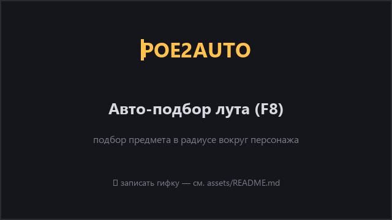
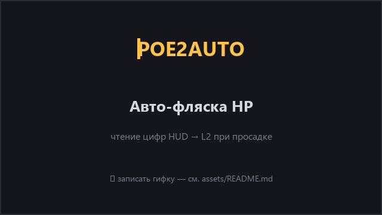

# POE2AUTO

Помощник для **Path of Exile 2** на геймпаде (DualSense). Подбирает лут, держит
авто-атаку и жмёт фляску — оставляя управление персонажем тебе. **Четыре режима
детекции мобов/HP** (`auto_attack.use_memory`):

- **`reader`** ⭐ (рекомендуется) — встроенный C#-ридер `PoE2ReaderLib.dll`
  читает память PoE2 через `PROCESS_VM_READ` **в один процесс** с ботом
  (грузится через pythonnet). Точные позиции/HP всех мобов, мгновенная фляска
  по реальным HP/Mana, фильтр «призраков» (спящие/декоративные мобы),
  SQLite-телеметрия с детектом убийств и kill-cooldown. Исходники
  C# лежат прямо в проекте (`poe2-reader/`).
- **`memory`** — старый external `PROCESS_VM_READ` (свой AOB-scan + авто-поиск
  оффсетов). Ломается при патчах PoE2, но умеет сам чинить оффсеты
  (`fix_offsets.bat`).
- **`false` / `cv`** — **только компьютерное зрение** по скриншоту, без
  чтения памяти. Универсальный fallback — работает везде, но видит только то,
  что на экране (полоса HP моба, а не точные позиции/HP).

> 💡 Если выбранный режим недоступен (нет DLL,
> PoE2 не запущен) — бот **автоматически откатывается на CV**, не падая.

> ⚠️ **Дисклеймер.** Любая сторонняя автоматизация нарушает правила GGG (ToS) и
> **может привести к бану аккаунта**. Режимы `reader`/`memory` читают
> внутренние структуры игры (`PROCESS_VM_READ`/инжект) — это повышенный риск по
> сравнению с CV. В память игра **не пишется**, только читается. Проект сделан
> для обучения и личных экспериментов. Используешь на свой страх и риск.

---

## Демо

<table>
  <tr>
    <td align="center"><br><sub><b>Авто-подбор лута (F8)</b></sub></td>
    <td align="center"><br><sub><b>Авто-фляска по цифрам HUD</b></sub></td>
  </tr>
</table>

<br>
<sub>Оверлей: авто-подбор · авто-фляска · <b>калибровка HUD</b> · fps/фокус</sub>

> 🎬 Сейчас здесь **плейсхолдеры**. Реальные записи кладутся в [`assets/`](assets/README.md) под теми же
> именами — README подхватит их сам.

---

## Содержание

1. [Для чего это и что умеет](#для-чего-это-и-что-умеет)
2. [Как это устроено](#как-это-устроено)
3. [Режимы детекции: почему мы ушли от чистого CV](#режимы-детекции-почему-мы-ушли-от-чистого-cv)
4. [Требования](#требования)
5. [Установка — по шагам](#установка--по-шагам)
6. [Первый запуск и калибровка](#первый-запуск-и-калибровка)
7. [Запуск бота](#запуск-бота)
8. [Хоткеи](#хоткеи)
9. [Настройка (config.yaml)](#настройка-configyaml)
10. [Диагностика HP](#диагностика-hp)
11. [Структура файлов](#структура-файлов)
12. [История изменений](#история-изменений)
13. [Решение проблем](#решение-проблем)

---

## Для чего это и что умеет

PoE2 на геймпаде требует много рутинных нажатий: подбор лута и постоянное обновление фляг. Этот бот
берёт рутину на себя, **оставляя управление персонажем тебе**.

- **🎮 Захват геймпада.** Реальный DualSense пробрасывается в виртуальный Xbox 360 (как в DS4Windows).
  Игра видит контроллер как Xbox, а бот шлёт свои команды в тот же виртуальный геймпад. Ты играешь
  как обычно — стики, кнопки, триггеры работают.

- **💰 Авто-подбор лута (F8).** Бот ищет на экране цвет-маркер твоего лут-фильтра, и когда предмет
  оказывается в радиусе вокруг персонажа — жмёт кнопку подбора (A / Cross). Он **не целится** (на
  геймпаде нет курсора) — просто добивает pickup, пока лут рядом. Где стоять — двигаешь ты.
  Детекция идёт только в **окне вокруг персонажа** (радиус подбора), а не по всему экрану —
  это держит высокий fps. Высокий порог насыщенности отсекает ложные цели от ярких эффектов на земле.

- **⚔️ Авто-атака (F2).** Когда вверху по центру появляется **полоса HP моба** (рарник/уник в бою),
  бот **держит R1** (авто-атака), а когда полоса пропадает — отпускает. Полосу ловит по **форме**
  (длинный тонкий сплошной красный прямоугольник) в зоне верх-центра — красные пятна сцены (камень/лава
  в красной локации) почти квадратные и отсекаются формой, факелы/иконки тоже не путаются. Держит
  только пока окно в фокусе; короткий грейс на отпускание сглаживает мерцание и добивает почти мёртвого
  моба. Управление у тебя — двигаешь и целишься сам, бот лишь жмёт атаку, пока цель жива.

  Детектор (`mob_bar.py`) работает в три уровня:
  1. **strict** — один большой бар (обычная цель/босс), строгие пороги ширины/aspect.
  2. **narrow** — толпа мобов рядом: у каждого бар мельче одного большого, но форма всё равно сильно
     вытянута (aspect ≥6) — отличимо от квадратистого декора сцены без задержки.
  3. **low_hp_lock** («добивание») — почти мёртвый моб: держит R1 по уже подтверждённой рамке, пока в
     ней остаётся хоть немного красного. Ограничено **жёстким потолком** от последнего строгого/narrow
     подтверждения (`low_hp_hard_cap_s`) — иначе может зависнуть на шумовых красных пикселях декора
     (найдено на рыжей листве, где R1 держался 20+ секунд без моба).

  Есть и четвёртый, **отключённый по умолчанию** уровень — `bootstrap` (для моба, увиденного уже
  подраненным с первого кадра). Код рабочий, но в лавовой/скальной локации не отличил декор от бара по
  форме (оба дали aspect~1.9) — включай осознанно (`bootstrap_enabled: true`) и следи за логом.

- **🧪 Авто-фляска HP.** Бот читает HP из **цифр HUD** (`Здоровье 1640/1640`) и при HP ниже порога
  жмёт L2 (фляга жизни). Трёхуровневый выбор источника:
  1. **цифры** читаются → решение по ним (точное `current/max`, ~1 мс/кадр, надёжнее бликов/руны);
  2. цифры пропали **ненадолго** (мелькание от эффекта в бою) → подстрахует **орб**;
  3. цифры пропали **надолго** (меню/перекрыт HUD) → **не пьёт ничем** (нет ложного спама L2 в меню).

  Смена экипировки не ломает чтение — максимум HP подстраивается сам. Слипшиеся цифры HUD (когда хвост
  `7` касается `1` в «371») распознаются разрезом по «долине» проекции — одно число вроде `0/1371` не
  теряется. Работает независимо от F8, пока окно игры в фокусе.

- **🧭 Авто-локализация HUD (портативность).** На старте бот **сам находит строку здоровья и орб** на
  экране — не нужно вручную обводить ROI при смене разрешения или UI Scale (и можно дать бота другу с
  другим монитором). Берёт верхнюю «ресурсную» строку `N/N` в нижне-левом углу (жизнь всегда первой —
  энергощит/барьер ниже не путаются с HP), а орб выводит от рамки цифр. Не нашёл сразу (меню/лоадинг) —
  ищет в фоне, пока не зацепит. Статус виден в оверлее (`поиск… → захват ✓`). Флаг `hp_num.auto_locate`.

- **🔧 Калибровка под твоё разрешение/фильтр.** Отдельные утилиты, чтобы мышкой обвести орб HP и
  подобрать цвет лута — настройки сохраняются в `config.yaml`. Шаблоны цифр **масштабонезависимы**
  (каждый глиф нормируется перед сравнением), поэтому при смене разрешения шрифт не перекалибровывают.

- **🩺 Диагностика.** Встроенный режим, который ловит сбои детекции HP и сохраняет скриншоты-улики
  с разбором причины (для отладки под конкретный билд/орб).

---

## Как это устроено

```
DualSense (raw HID) ──bridge──▶ Virtual Xbox 360 (ViGEmBus) ──▶ PoE2
  ┌─ экран ──grab──▶ CV: цвет лута / цифры HP (orb fallback) ──▶ A / L2
  │  (dxcam/mss + OpenCV)        CV-фляска: порог по цифрам/орбу
  │
  └─ память PoE2 ──read──▶ детекция мобов (одна из стратегий ниже) ──▶ R1
     ├─ reader: PoE2ReaderLib.dll (C#) в процессе через pythonnet      ⭐
     └─ memory: external PROCESS_VM_READ + AOB scan
```

- **Почему через виртуальный Xbox:** PoE2 игнорирует виртуальные геймпады, когда подключён реальный
  DualSense. Решение (как у DS4Windows): создаём виртуальный Xbox 360, прячем физический DualSense
  через **HidHide**, а его ввод пробрасываем мостом. Игра видит только виртуальный Xbox.
- **Захват экрана** (нужен всегда — для лута и CV-фляски): через `dxcam` (быстрый, DirectX), с
  автоматическим фолбэком на `mss`.
- **Всё остальное (мобы/HP) — по данным:** две стратегии чтения памяти (`reader`/`memory`)
  дают одинаковый результат через единый интерфейс детектора. Какая именно — см. след. раздел.
- **Чтение HP:** в режимах `reader`/`memory` берётся **реальное** HP/Mana из `Life`-компонента
  сущности (точно). В чистом `cv` — HP игрока по цифрам HUD через template matching (OpenCV, без
  ML/OCR-движка, ~1 мс/кадр), орб как запасной источник.

---

## Режимы детекции: почему мы ушли от чистого CV

CV-стек (зрение по скриншоту) — безопасный фундамент: не трогает память игры, работает везде. Но у
него есть **фундаментальные ограничения**, которые чтение памяти решает кардинально:

| Проблема чистого CV | Как решает чтение памяти |
|---------------------|--------------------------|
| Видит **только** полосу HP моба, когда она показана вверху. Моб вне кадра / за углом / без полосы — **не существует** для бота. | Видит **всех** мобов в зоне: позиции, HP, дистанцию до каждого — даже тех, кто не на экране. |
| HP игрока — догадка по цифрам HUD / орбу: **шрифт, блики, руна, меню** всё ломают чтение. Фляска то не срабатывает, то спамит. | HP/Mana — **точные числа** из `Life`-компонента. Фляска срабатывает ровно по порогу, без ложных срабатываний. |
| Не отличить живого моба от **спящего/декоративного** (полосы нет → не атакует, или наоборот — ложная атака по красному декору). | Видит флаг жизни, движение, полученный урон. Фильтр «призраков» отсекает спящих утопленников, бот не зависает на невидимых целях. |
| Радиус атаки — догадка по размеру полосы на экране. Не работает на 4K / при смене UI Scale без перекалибровки. | Радиус — в **игровых grid-координатах**, одинаковых при любом разрешении. |
| Не знает, **сколько врагов вокруг** и кто ближайший — нельзя приоритизировать цели. | Сортировка целей по HP/дистанции/rarity, счётчик врагов в радиусе — прямо в оверлее. |

Именно поэтому проект перешёл на **мульти-бэкенд**: CV остаётся **fallback'ом** (всегда работает, не
нужны оффсеты), а основные режимы читают память. Какой именно способ чтения — выбираешь в
`auto_attack.use_memory`:

| Режим | Бэкенд | Оффсеты | Риск на патчах | Когда выбирать |
|-------|--------|---------|----------------|----------------|
| **`reader`** ⭐ | C# DLL (`PoE2ReaderLib.dll`) в процессе через pythonnet | правишь в `Program.cs` | средний (1 файл поправить + пересобрать) | **по умолчанию** — один процесс, без TCP, исходники в проекте |
| `memory` | external `PROCESS_VM_READ` (свой AOB-scan) | свои, с авто-поиском | высокий, но авто-чинится (`fix_offsets.bat`) | если нет C# DLL |
| `false`/`cv` | только OpenCV по скриншоту | не нужны | — | безопасный fallback, не трогает память |

> Все три детектора реализуют **один интерфейс** (`present()`, `get_hostiles_in_range()`,
> `read_player_vitals()`, `in_hideout()`, …) — `bot.py` работает с любым из них одинаково и
> **автоматически откатывается на CV**, если выбранный режим недоступен. Подробно — в
> [`docs/READER_SETUP.md`](docs/READER_SETUP.md).

### Сборка reader-режима (один раз)
Режим `reader` требует собранную DLL из исходников `poe2-reader/` (бинарник не хранится в git):
```powershell
build_reader.bat          # нужен .NET 8 SDK (dotnet --version)
```
После сборки бот сам найдёт DLL (относительный путь). Когда собирать заново — см.
[`docs/READER_SETUP.md`](docs/READER_SETUP.md).

---

## Требования

| Что | Требование |
|-----|-----------|
| **ОС** | Windows 10/11 (x64) |
| **Python** | 3.10+ (проект тестировался на Anaconda) |
| **Геймпад** | Sony DualSense (PS5), подключённый по USB или Bluetooth |
| **Права** | Запуск с правами **администратора** (нужно для ViGEmBus; для режимов `reader`/`memory` — ещё и для `PROCESS_VM_READ` в PoE2) |
| **Драйвер 1** | **ViGEmBus** — виртуальный геймпад |
| **Драйвер 2** | **HidHide** — спрятать физический DualSense от игры |
| **Опц. (.NET 8 SDK)** | нужен только режиму `reader` (`auto_attack.use_memory: reader`) — для сборки C# DLL. Скачать: <https://dotnet.microsoft.com/download>. Проверка: `dotnet --version`. Без него читающий режим работать не будет, но бот откатится на CV. |

### Python-библиотеки (`requirements.txt`)

| Библиотека | Зачем |
|-----------|-------|
| `vgamepad` | Создаёт виртуальный Xbox 360 (обёртка над ViGEmBus) |
| `hidapi` | Чтение сырых HID-репортов DualSense (`import hid`) |
| `opencv-python` | Компьютерное зрение: маски цвета, анализ орба (`cv2`) |
| `numpy` | Работа с массивами кадров |
| `dxcam` | Быстрый захват экрана через DirectX |
| `mss` | Запасной захват экрана (фолбэк, если dxcam недоступен) |
| `pywin32` | Поиск окна PoE2, проверка фокуса (`win32gui`, `win32api`) |
| `PyYAML` | Чтение/запись `config.yaml` |
| `Pillow` | Отрисовка справки в окне калибровки HP |
| `pynput` | Глобальные хоткеи (F2/F3/F7/F8/F9/F12) |
| `pythonnet` | Режим `reader`: загрузка C# DLL `PoE2ReaderLib.dll` в процесс Python (coreclr) |

---

## Установка — по шагам

### 1. Скачать проект
```powershell
git clone https://github.com/fakingpescobar-ctrl/POE2AUTO.git
cd POE2AUTO
```

### 2. Установить Python-зависимости
```powershell
pip install -r requirements.txt
```

### 3. Установить драйвер ViGEmBus
- Скачать с релизов: <https://github.com/nefarius/ViGEmBus/releases>
- Установить `.exe`, перезагрузка обычно не требуется.
- Без него `vgamepad` не сможет создать виртуальный геймпад.

### 4. Установить и настроить HidHide
- Скачать с релизов: <https://github.com/nefarius/HidHide/releases>
- Установить, открыть **HidHide Configuration Client**:
  1. Вкладка **Applications** → добавить в whitelist свой `python.exe`
     (тот, которым запускаешь бота, напр. `%USERPROFILE%\anaconda3\python.exe`).
  2. Вкладка **Devices** → найти DualSense и поставить галку **Hide** (спрятать от остальных программ).
- Смысл: PoE2 перестаёт видеть физический DualSense и видит только виртуальный Xbox, который шлёт
  бот. `python.exe` при этом физический DualSense видит (он в whitelist) и пробрасывает ввод.

### 5. Подключить DualSense
- По USB или Bluetooth. Проверь, что Windows его определила.

> Порядок установки драйверов до запуска бота важен. Запускай бота **с правами администратора**
> (батники делают авто-elevation).

### 6. (Опц.) Собрать C# ридер для режима `reader`
Если хочешь детекцию мобов по памяти (`auto_attack.use_memory: reader`, рекомендуется), собери
DLL из исходников `poe2-reader/` (нужен **.NET 8 SDK** — см. [Требования](#требования)):
```powershell
build_reader.bat
```
Результат: `poe2-reader\lib\bin\Release\net8.0\PoE2ReaderLib.dll` (бот найдёт её сам по
относительному пути). Без этого шага бот просто откатится на CV-режим. Подробнее —
[`docs/READER_SETUP.md`](docs/READER_SETUP.md).

---

## Первый запуск и калибровка

### Тест захвата геймпада (опционально)
```powershell
run.bat
```
Поднимает виртуальный Xbox + мост. Проверь, что в игре персонаж управляется с DualSense как обычно.
Запускать **до** входа в PoE2.

### Калибровка лута (для авто-подбора)
```powershell
calibrate.bat
```
Подбери цвет-маркер своего лут-фильтра, пороги и радиус подбора. Сохрани — попадёт в `config.yaml`.

### Калибровка орба HP (для авто-фляски) — обязательно для фляски
```powershell
calibrate_hp.bat
```
- **ЛКМ** — кликни в центр орба HP.
- Трекбар **Radius** — обведи белым кругом орб **точно по сфере жидкости** (без декоративной оправы снизу).
- **Threshold** — порог в %, ниже которого пить флягу.
- **RedSat / RedVal** — пороги «красного» (подними, если в маску лезет фон; опусти, если орб тусклый).
- **`d`** — debug-снимок, **`s`** — сохранить (включает автофляску), **`q`** — выход.

> Если на орбе есть постоянный символ/руна-механика или глянцевый блик — детекция может занижать HP.
> См. параметры `rune_frac`, `full_ratio`, `valid_val` в [config.yaml](#настройка-configyaml) и
> раздел [Диагностика HP](#диагностика-hp).

### Калибровка цифр HP (основной источник HP) — рекомендуется
```powershell
run_calibrate.bat
```
Бот читает HP из цифр HUD (`Здоровье 1640/1640`) — это надёжнее орба. Для этого нужны шаблоны
цифр под твой шрифт/разрешение (один раз). Калибратор **держит виртуальный геймпад сам** (чтобы не
кикало из игры), поэтому `run_bot.bat` на время калибровки должен быть **закрыт**.

- ROI строки обычно **искать вручную не нужно** — при `hp_num.auto_locate: true` бот находит её сам на
  старте (см. «Авто-локализация HUD»). `hp_num.roi` в конфиге остаётся стартовым/запасным значением.
- Если авто-локализация почему-то не цепляется (очень мелкий шрифт) — задай зону цифр в `config.yaml`
  → `hp_num.roi` (доли кадра для строки «Здоровье») и свой `hp_num.max_hp` вручную.
- Если не хватает **ровно одной** цифры — калибратор сам копит кадры-кандидаты в `_debug/digit_caps/`,
  пока ты играешь и получаешь урон (реген не мешает). Иначе — ручной режим: смотришь
  `_debug/hp_nums_cap.png` и вписываешь, что видишь, на разном HP, пока не соберутся все `0-9` и `/`.
- Шаблоны сохраняются в `hp_digits/*.png`. После — перезапусти `run_bot.bat`, в логе появится
  `Чтение HP по цифрам ВКЛ`, а в статусе HP с источником: `hp=85%(num)`.

> Пока цифры не откалиброваны, `hp_num` не активируется и бот читает HP **по орбу** (как раньше).
> Смена экипировки с другим max HP перекалибровки **не требует** — максимум подстраивается сам.

---

## Запуск бота

```powershell
run_bot.bat
```
- Запускать **ДО** входа в PoE2 (или до того, как игра захватит геймпад).
- Поднимает виртуальный Xbox + мост DualSense + захват экрана + детекторы.
- Авто-фляска работает сразу (если откалибрована; вкл/выкл — F3), авто-подбор — по F8.
- Режим авто-атаки (F2) задаётся в `config.yaml` → `auto_attack.use_memory`:
  - `reader` (рекомендуется) — нужна собранная DLL (`build_reader.bat`) + права админа;
  - `memory` — права админа (для `OpenProcess` / `PROCESS_VM_READ`);
  - `false`/`cv` — работает сразу, без памяти (fallback).
  В логе видно какой режим активен (`READER`/`MEMORY`/`CV`) и причину отката на CV, если был.

> ⚠️ Запускай только **один** экземпляр. Не запускай `run.bat` и `run_bot.bat` одновременно — будет
> два виртуальных контроллера.

---

## Хоткеи

| Клавиша | Действие |
|---------|----------|
| **F8** | Вкл/выкл авто-подбор лута |
| **F2** | Вкл/выкл авто-атаку (держит R1, пока виден HP-бар моба) |
| **F3** | Вкл/выкл авто-фляску HP (по умолчанию ВКЛ при старте) |
| **F7** | Вкл/выкл диагностику HP (дамп улик; **тормозит — только для отладки**) |
| **F9** | Ручной снимок-улика (для диагностики) |
| **F6** | Показать/скрыть оверлей статусов |
| **F12** | Выход |

### Оверлей статусов

Поверх игры рисуется полупрозрачная панель (tkinter, click-through — клики проходят в игру, фокус не
ворует) со статусами: **авто-подбор** (ON/OFF), **авто-атака** (`OFF / ждёт / АТАКА ⚔` — когда держит R1 на мобе),
**авто-фляска** + текущий **HP%** (цвет по уровню), **калибровка HUD** (`поиск… → захват ✓ 1371/1371` —
видно, что авто-локализация зацепила строку HP), **диагностика** (ON/OFF), счётчики фляг/подборов, fps
и индикатор фокуса окна. Скрыть/показать — **F6**.
Работает поверх **оконного/безрамочного** режима (не поверх эксклюзивного фуллскрина).

---

## Настройка (`config.yaml`)

Файл создаётся/обновляется калибраторами, но можно править руками. Основные параметры:

### Игра и захват
```yaml
game:
  window_title: Path of Exile 2   # подстрока заголовка окна
capture:
  backend: dxcam                   # dxcam | mss
```

### Лут (`vision` + `loot`)
```yaml
vision:
  marker_rgb: [235, 0, 185]        # цвет-маркер лут-фильтра (RGB)
  extra_colors: []                 # доп. цвета (мульти-маркер)
  hue_tolerance: 8                 # допуск по оттенку
  sat_min: 200                     # мин. насыщенность (высокий = отсекает тусклые эффекты, лейблы лута S=255 проходят)
  val_min: 120                     # мин. яркость
  min_blob_area: 200               # мин. площадь пятна (px) — отсев мелкого шума
loot:
  pickup_radius_px: 250            # радиус подбора вокруг персонажа
  center_offset_xy: [0, -40]       # смещение центра персонажа от центра кадра
  cooldown_ms: 100                 # пауза между нажатиями подбора
  pickup_hold_ms: 60               # сколько держать кнопку A
  pickup_button: a                 # кнопка подбора (Xbox-раскладка)
```

### Авто-фляска HP (`hp` — орб, запасной источник)
```yaml
hp:
  enabled: true                    # вкл (ставит калибратор)
  orb: {cx: 0.0732, cy: 0.8712, r: 0.0799}  # центр/радиус орба (доли кадра)
  threshold: 0.88                  # пить, когда HP ниже этой доли
  cooldown_ms: 333                 # пауза между флягами
  flask_button: left_trigger       # left_trigger (L2) | right_trigger (R2)
  flask_hold_ms: 120               # длительность нажатия триггера
  confirm_frames: 1                # сколько низких кадров подряд перед флягой
  red_sat_min: 24                  # порог насыщенности красного
  red_val_min: 52                  # порог яркости красного
  row_fill_frac: 0.28              # доля красного в строке, чтобы считать её «залитой»
  rune_frac: 0.38                  # ширина центральной полосы с руной — исключается из скана
  bottom_trim_frac: 0.05           # подрезка тёмного нижнего обода/таскбара
  full_ratio: 0.78                 # сколько читается при ПОЛНОМ HP: real = measured/full_ratio
  valid_val: 45                    # мин. яркость залитой части (ниже = орб затемнён → не пьём)
  fallback_red_frac_min: 0.04      # мин. доля красного, чтобы fallback сработал на слепом кадре
                                   # (отличает просадку под эффектом от тёмного орба в меню)
  tripwire: true                   # доп. рубеж (только для диагностики, в решении не участвует)
```

### Чтение HP по цифрам (`hp_num` — основной источник)
```yaml
hp_num:
  enabled: true                    # вкл (активируется, когда откалиброваны все шаблоны)
  auto_locate: true                # на старте сам найти строку HP и орб на экране
                                   # (портативность между разрешениями/UI Scale; не нашёл — ищет в фоне)
  roi: {x1: 0.066, y1: 0.700, x2: 0.137, y2: 0.735}  # зона строки «Здоровье» (стартовая/fallback, доли кадра)
  bin_thr: 130                     # порог бинаризации (белый текст)
  match_min: 0.55                  # мин. совпадение глифа с шаблоном
  min_glyph_h: 10                  # мин. высота глифа (px) — отсев шума
  max_hp: 1640                     # стартовый max HP (отсев мусора; дальше подстраивается сам)
  menu_grace_s: 0.5                # цифры нет дольше этого = меню/перекрыт HUD → не пьём
                                   # (в пределах окна орб подстрахует мелькание в бою)
auto_attack:                       # держать R1, пока виден HP-бар моба вверху (F2)
  enabled: true
  button: right_bumper             # какую кнопку держать: R1 (right_bumper) и др.
  roi: {x1: 0.36, y1: 0.02, x2: 0.64, y2: 0.12}  # зона полосы HP моба (доли кадра)
  red_sat_min: 150                 # порог насыщенности красного (UI-красный насыщеннее камня сцены)
  red_val_min: 90                  # порог яркости красного полосы
  # полосу отличаем от красных пятен сцены по ФОРМЕ (длинная, тонкая, сплошная):
  min_run_frac: 0.018              # мин. ширина красной компоненты (доля ширины кадра)
  max_h_frac: 0.030                # макс. высота (доля высоты) — полоса тонкая, пятно сцены высокое
  min_aspect: 3.0                  # w/h — полоса вытянута (пятно сцены ≈ квадрат)
  min_fill: 0.45                   # area/(w*h) — полоса сплошная
  release_grace_s: 0.35            # держать R1 ещё столько после пропажи полосы (сглаживание/добив)
  low_hp_lock_timeout_s: 5.0       # «добивание»: сколько держать R1 по старой рамке без подтверждений
  low_hp_min_px: 6                 # мин. красных пикселей в старой рамке, чтобы считать бар живым
  low_hp_hard_cap_s: 6.0           # жёсткий потолок с последнего РЕАЛЬНОГО (strict/narrow) подтверждения —
                                   # добивание не продлевает само себя бесконечно на шуме декора
  narrow_enabled: true             # узкие бары толпы мобов (см. описание фичи выше)
  narrow_min_w_frac: 0.02
  narrow_min_aspect: 6.0
  bootstrap_enabled: false         # моб, увиденный уже подраненным — ВЫКЛ по умолчанию, см. описание фичи
hotkeys:
  toggle: f8
  diag: f7
  snapshot: f9
  overlay: f6
  attack: f2
  flask: f3
  quit: f12
```

**Ключевые «спасательные» параметры детекции HP** (если орб нестандартный):
- `rune_frac` — если по центру орба есть постоянный символ/руна, не дающая распознать красное.
- `full_ratio` — если при полном HP детектор показывает меньше 100% (из-за блика/тени на верху орба).
- `valid_val` — если на низком HP бот теряет орб (читает `hp=-`): понизь порог яркости.
- `confirm_frames` — `1` = жать с первого низкого кадра (быстрее, безопаснее для выживания).

---

## Диагностика HP

Если автофляска «слепнет» (в логе `hp=- v=0`) или ведёт себя странно — включи диагностику.

**Вариант 1 — вживую (с геймпадом и флягой):** запусти `run_bot.bat`, нажми **F7**. При каждой потере
HP бот сохраняет улики в `_debug/hp_events/` (весь экран + кроп орба + маска красного + оверлей) и
пишет разбор причины в `bot.log`.

**Вариант 2 — без геймпада (чистый анализ):**
```powershell
hp_diag.bat
```
Пишет в `hp_diag.log`, **F9** — ручной снимок, **F12** — выход.

Эвристики причины в логе: *чёрный кадр* (захват не отдал картинку) · *нет красного* (орб перекрыт
эффектом / регион сместился) · *тусклый орб* (меню/затемнение) · *отсечено гейтом валидности*.

> ⚠️ F7-диагностика грабит полный кадр и пишет PNG — это **снижает fps и добавляет задержку фляге**.
> Для обычной игры держи F7 **выключенным**.

### Диагностика лута (ложные цели)

Если бот тыкает подбор там, где лута нет (ловит цвет от эффектов на земле), включи автоподбор (**F8**)
и нажми **F9** — рядом со снимком HP сохранится **лут-снимок** в `_debug/hp_events/*_loot_*.png`
(кадр + маска + найденные точки с радиусом подбора) и список точек с координатами/площадью в `bot.log`.
По маске видно, что детектор принял за лут — и можно поднять `vision.sat_min` / `min_blob_area`.

---

## Структура файлов

| Файл | Роль |
|------|------|
| `bot.py` | Главный бот: захват + детект + подбор + фляска + диагностика |
| `main.py` | Минимальный запуск только захвата геймпада (этап 1) |
| `virtual_xbox.py` | Виртуальный Xbox 360 (vgamepad) + heartbeat, потокобезопасный |
| `dualsense_bridge.py` | Чтение DualSense по HID, форвард в виртуальный Xbox |
| `screen.py` | Захват экрана (dxcam → mss) |
| `window.py` | Поиск окна PoE2 + клиентская область + фокус |
| `color_detector.py` | HSV-маска лута → центры целей |
| **Детекция мобов** | |
| `mob_bar.py` | Детект полосы HP моба вверху (CV-режим, fallback) |
| `reader_detect.py` | Детектор мобов через встроенный C# ридер (режим `reader`) + фильтр «призраков» + kill-cooldown |
| `reader_bridge.py` | Python-обёртка над C# DLL `PoE2ReaderLib.dll` (pythonnet) |
| `monster_db.py` | **SQLite-телеметрия мобов**: история по имени/адресу, детект убийств, кулдаун между сессиями, счётчики |
| `mem_detect.py` | Интеграция external `PROCESS_VM_READ` с авто-атакой (режим `memory`) |
| `game_memory.py` | Read-only доступ к памяти PoE2 (NtReadVirtualMemory, AOB scan) |
| `game_offsets.py` | Оффсеты структур PoE2 (GameState → Entity → Component) |
| `entity_reader.py` | Обход AwakeEntities, категоризация сущностей, чтение компонентов |
| `offset_scanner.py` | Авто-обнаружение оффсетов (5 стратегий: AOB/brute/value-scan) |
| `offset_discovery.py` | Старый value-scan жизненных пулов (Health/Mana/ES) |
| `auto_flask.py` | Движок правил авто-фляски (по HP/Mana/врагам из памяти) |
| `entity_overlay.py` | Оверлей сущностей (позиции мобов/игрока) |
| **Навигация** | |
| `core_map.py` | Core Mapping: grid-карта (walkable по Terrain), построение пути (A*), мировые/грид-координаты |
| `nav_worker.py` | Фоновый поток навигации: читает `nav_target.json`, ведёт персонажа к waypoint'ам (через `vx.set_left_stick`) |
| `map_run_flow.py` | Прогон карты: навигация до цели + авто-телепорт из города в бродяжку |
| `stash_flow.py` / `stash_reader.py` / `stash_tab_browser.py` | Работа со стойкой: список вкладок, фильтр/чтение карт (по памяти) |
| `probe_cast.py` | Поиск игрока и компонентов сущностей (используется `core_map`) |
| `screen_capture.py` | Захват экрана (используется `map_run_flow`) |
| **HP игрока** | |
| `hp_ocr.py` | Чтение HP по цифрам HUD (template matching, разрез слипшихся) — CV-источник HP |
| `hp_locate.py` | Авто-локализация строки HP и орба на старте (портативность) |
| `hp_detector.py` | Детекция HP по орбу (скан уровня жидкости + коррекции) — fallback |
| `hp_engine.py` | Логика решения: цифры vs орб, грейсы, анти-глитч |
| **Остальное** | |
| `loot_engine.py` | Радиус подбора + кулдаун |
| `overlay.py` | Оверлей статусов + счётчики сущностей + радиус атаки (F4) |
| `diag_dump.py` | Сохранение улик при потере HP (общий код) |
| `hp_diag.py` | Анализатор потери HP без геймпада |
| `calibrate.py` / `calibrate_hp.py` | Калибровка маски лута / орба HP |
| `calibrate_hp_digits.py` | Калибровка шаблонов цифр HP (с живым геймпадом) |
| `hp_digits/` | Шаблоны цифр `0-9` и `/` (результат калибровки цифр) |
| `config.py` / `config.yaml` | Конфиг (дефолты + сохранённая калибровка) |
| `poe2-reader/` | **C# ридер памяти** (`Program.cs`, csproj) — часть проекта, см. `docs/READER_SETUP.md` |
| `_bench_*.py` | Бенчмарки производительности детектора (`_bench_update.py` — полный цикл, `_bench_profile.py` — поэтапно, `_bench_cprofile.py` — с обходом throttle) |
| `*.bat` | Скрипты запуска (см. ниже) |

**Батники:** `run_bot.bat` (основной бот) · `build_reader.bat` (сборка C# DLL для `reader`) ·
`fix_offsets.bat` (авто-починка оффсетов для `memory`) ·
`calibrate.bat` (лут) · `calibrate_hp.bat` (орб HP) · `run_calibrate.bat` (цифры HP) ·
`hp_diag.bat` (диагностика без геймпада) · `run.bat` (тест захвата геймпада).

---

## История изменений

### Что сделано (последняя сессия: оптимизация ридера, 2026-08)

- **Кэш классификации `_status_by_id`** (P1): `_classify_target` теперь вызывается
  **один раз на моба за кадр** (раньше 3-5 раз: в `update()` + в каждом query-вызове
  из `bot.py`). `get_all_hostiles` / `get_hostiles_in_range` / `get_best_target`
  читают кэш кадра вместо повторной дорогой классификации.
- **Один проход по сущностям** (P2): `_update_static_track` + `_track_projectiles`
  объединены в `_update_tracks` — раньше каждый делал свой полный проход по списку
  (1172+/кадр), теперь один цикл собирает и «призраков», и снаряды.
- **Дедуп телеметрии** (P3): в `monster_db` пишутся только мобы, у которых
  изменились (статус/HP%/позиция) — рост БД падает в 10-20 раз. Детект убийств
  строится на переходах COMBAT→DEAD (они всегда пишутся), дедуп их не теряет.
  Включается `monster_db.dedup: true` (по умолчанию).
- **Чистка `_dead_track`** (P0): записи старше `corpse_timeout_s` удаляются раз в
  `corpse_timeout/2` сек. Раньше словарь рос бесконечно, а переиспользованный
  адрес заставлял свежего моба навсегда считаться трупом (не атаковался).
- **Confidence только для hostile-мобов** (P4a): `_compute_confidence` больше не
  зовётся для chests/NPC/дружелюбных (2 dict-lookup'а на каждую сущность кадра
  экономится; для них confidence = 0.0).
- **Итоговая производительность**: полный `update()` 11.5 мс (87 Гц) при
  целевых 20 Гц — запас в 4×. Синтетический бенч 1172 сущности: query-методы
  +50% быстрее после фикса кэша (см. таблицу ошибок).

### Что было сделано (прошлая сессия: телеметрия, kill-cooldown, навигация)

- **SQLite-телеметрия мобов** (`monster_db.py`): полный дамп всех мобов по кадрам в `monster_telemetry.db`
  (категория, позиции, HP, статус, timestamp) — для дебага, аналитики и **детекта убийств**.
- **Kill-cooldown**: бот запоминает недавно убитых мобов (по адресу из телеметрии) и не тратит на них
  авто-атаку — цель переключается на живых. Кулдаун переживает респавн сессии.
- **Ghost-фильтр доработан**: спящий/статичный моб (не двигался и не получал урон) не считается
  целью, пока не «оживёт»; Rare/Unique/боссы фильтром не отсекаются.
- **Навигация (CoreMap)**: `core_map.py` (grid-карта + A* по Terrain) + `nav_worker.py`
  (фоновый поток ведёт персонажа по waypoint'ам через левый стик) + `map_run_flow.py`
  (авто-прогон карты с телепортом из города).
- **Бенчмарки** (`_bench_update.py`, `_bench_profile.py`, `_bench_cprofile.py`): замер реальной
  производительности цикла детекции — полный update, поэтапный разбор, cProfile.

### Все наши ошибки (найдено и исправлено)

| Ошибка | Симптом | Причина | Фикс |
|--------|---------|---------|------|
| **Фриз детектора на ~3 сек каждые 100 мс** | Авто-атака не успевала реагировать: update() реально 480 мс (2.1 Гц вместо 20 Гц), бот «проспал» подходящего моба | SQLite-запрос `get_recently_killed_addrs` выполнялся **3103 мс**: БД раздулась до 1.1M строк (сессия 358k) без индекса по `(session_id, status, ts)` | Составной индекс `idx_session_status_ts` в `_SCHEMA` → запрос **0.6 мс** (в 5000× быстрее) |
| **Кэш кулдауна убийств чистился слишком часто** | Ридер «вставал» каждые 100 мс на пересоздание кэша из SQLite | `_kill_cooldown_cache_ttl = 0.1` сек — обновление кэша блокировало цикл | TTL поднят до **2.0 сек** — частота запросов к БД упала в 20 раз |
| **Атака «призраков»** | Бот держал R1 на мобе, который не двигался и был невидим (утопленник/декор) | Живой (по данным) статичный моб считался целью | Ghost-фильтр: `distance <= attack_range and is_alive and hp_current > 0` → цель; статичных пропускает, пока не зашевелятся |
| **Ошибка формата в диагностиках** | `_diag_5min.py` / `_diag_live.py` падали при появлении первого монстра | Лишний `%s` в format-строке списка мобов (10 плейсхолдеров на 9 аргументов) | Убран лишний плейсхолдер — снимки пишутся стабильно |
| **Мёртвый кэш классификации** | `get_hostiles_in_range` не использовал кэш `_status_by_id` — каждый query-вызов заново вызывал дорогой `_classify_target` (в 3-5 раз чаще нужного) | Опечатка: переменная `st` бралась из кэша, но в цикле читалось `self._classify_target(e)` вместо `st.get(e.id)` | Исправлено на `st.get(e.id)` — query-методы +50.6% быстрее (0.75 → 0.38 мс на 1172 сущностях). Найдено ревью модели GLM 5.2 |
| **Вечный рост `_dead_track`** | Словарь «убитых» рос бесконечно всю сессию, а переиспользованный игрой адрес заставлял свежего моба навсегда считаться трупом — бот его не атаковал | Чистки `_dead_track` не было вовсе | Раз в `corpse_timeout/2` сек удаляются записи старше `corpse_timeout_s` (свидание — «свежий моб-труп» исчезает) |

### Что изменили

- `reader_detect.py` (текущая сессия): кэш `_status_by_id` + фикс `get_hostiles_in_range`
  (`st.get(e.id)`); `_update_tracks` вместо `_update_static_track`+`_track_projectiles`;
  чистка `_dead_track` (`_dead_track_cleanup_ts`); confidence только для hostile-мобов.
- `config.yaml`: `monster_db.dedup: true` (дедуп телеметрии).
- `tests/test_reader_detect.py`: +2 теста на чистку `_dead_track`, кэш классификации.
- `monster_db.py`: индекс `(session_id, status, ts)` в схеме БД; запросы по сессии/статусу/времени.
- `reader_detect.py`: TTL кэша kill-cooldown `0.1 → 2.0 сек`; доработан ghost-фильтр
  (`_check_static`); kill-cooldown теперь не блокирует update-цикл.
- `bot.py`: интеграция NavWorker, map-run-flow, stash-флоу; запуск по `run_bot.bat`.
- Удалён **EC2-код** (`ec2_client.py`, `ec2_detect.py`, `bot_ec2_lite.py`, `setup_ec2.bat` и
  `tests/test_ec2_detect.py`) — вынос детекции на облако больше не нужен, всё локально.
- `tests/test_reader_detect.py`: +170 строк тестов (сценарии TestFrameScenario — ghost-фильтр,
  kill-cooldown, классификация мобов).

### Что добавили (новые файлы)

- `monster_db.py` — SQLite-телеметрия и детект убийств.
- `core_map.py`, `nav_worker.py`, `map_run_flow.py`, `probe_cast.py` — навигация (CoreMap).
- `stash_flow.py`, `stash_reader.py`, `stash_tab_browser.py`, `screen_capture.py` — работа со стойкой
  и захват для map-run.
- `_bench_update.py`, `_bench_profile.py`, `_bench_cprofile.py` — бенчмарки.
- `AGENTS.md` — локальные правила проекта.

---

## Решение проблем

| Симптом | Что проверить |
|---------|---------------|
| В логе «откат на CV» / оверлей показывает режим `CV` вместо `READER` | Для `reader`: собрана ли DLL (`build_reader.bat`, нужен .NET 8 SDK)? Есть ли `poe2-reader/lib/bin/.../PoE2ReaderLib.dll`? Запущен ли PoE2? Бот от админа? |
| `MemoryError`/`FileNotFound: PoE2ReaderLib.dll` | Пересобери DLL: `build_reader.bat`. Если `dotnet` не найден — установи .NET 8 SDK. Путь к DLL можно переопределить переменной окружения `POE2READER_DLL`. |
| Бот держит R1 по невидимому мобу (вода/декор) | Это «призрак»: фильтр включён (`auto_attack.ignore_static_mobs: true`) — подними `static_grace_s`, чтобы дать мобу больше времени шевельнуться. Rare/Unique/боссы фильтром не отсекаются. См. `docs/READER_SETUP.md`. |
| Бот «тормозит» / авто-атака не успевает на моба | Разросшаяся `monster_telemetry.db` (индекс `(session_id, status, ts)` отсутствует в старой БД). Проверка: `EXPLAIN QUERY PLAN` на `get_recently_killed_addrs` должен показывать `SEARCH USING INDEX idx_session_status_ts`; если нет — создай индекс вручную (`CREATE INDEX idx_session_status_ts ON monster_events(session_id, status, ts)`). |
| После патча PoE2 мобы не детектятся (`memory`-режим) | Оффсеты устарели — запусти `fix_offsets.bat` (авто-поиск). Или переключись на `reader` (меньше риск на патчах). |
| `vgamepad` не создаёт геймпад | Установлен ли **ViGEmBus**? Запущен ли бот **от администратора**? |
| Игра не реагирует на геймпад | Настроен ли **HidHide** (DualSense скрыт, `python.exe` в whitelist)? Запущен ли бот **до** игры? |
| Двойное управление / дёргается | Запущено два экземпляра (`run.bat` + `run_bot.bat`). Оставь один. |
| Фляга не срабатывает | Окно игры в фокусе? `hp.enabled: true`? Орб откалиброван (`calibrate_hp.bat`)? |
| В логе `hp=...(orb)` вместо `(num)` | Цифры не читаются — проверь `hp_num.roi` и шаблоны (`run_calibrate.bat`); бот пока на орбе. |
| В оверлее «Калибровка HUD: поиск…» не сменяется на «захват ✓» | HUD не виден (меню/лоадинг) — войди в игру; если и в игре не цепляет — шрифт мелкий, задай `hp_num.roi` вручную или выключи `hp_num.auto_locate`. |
| Сменил разрешение/UI Scale — HP не читается | При `hp_num.auto_locate: true` бот переедет сам (см. оверлей). Если нет — `run_calibrate.bat` под новый шрифт. |
| Цифры HP читаются неверно | Подстрой `hp_num.bin_thr`/`match_min`, проверь `_debug/hp_nums_cap.png`; перекалибруй при смене разрешения. |
| Жмёт L2 в меню | HUD скрыл цифры — должно само прекратиться через `hp_num.menu_grace_s`; если спамит дольше — уменьши параметр. |
| В логе `hp=- v=0` | Орб теряется — см. [Диагностика HP](#диагностика-hp); подстрой `rune_frac`/`full_ratio`/`valid_val`. |
| Фляга жмёт при полном HP | `full_ratio` занижен под твой орб — подними к реально читаемому при 100%. |
| Фляга с задержкой ~1.5с | Выключи **F7** (диагностика тормозит). Для игры F7 должен быть off. |
| Бот тыкает подбор без лута | Эффект на земле ловится как лут — см. [Диагностика лута](#диагностика-лута-ложные-цели); подними `vision.sat_min`/`min_blob_area`. |
| Авто-атака не держит R1 | Включена (F2, в оверлее `ждёт/АТАКА`)? Окно в фокусе? Полоса моба в зоне `auto_attack.roi`? Если бар короткий/толпа мобов — должен ловить уровень `narrow` (лог `kind=narrow`); если и он не ловит, понизь `narrow_min_aspect`. |
| Авто-атака держит R1 без моба | Что-то красное в зоне ловится как полоса — подними `min_run_frac`/`red_sat_min` или сузь `auto_attack.roi`. Если держится ДОЛГО (10+с) без единого `kind=strict/narrow` в логе — это `low_hp_lock` завис на шуме декора, уменьши `low_hp_hard_cap_s`. |
| Моб уже подраненный при появлении — бот его не атакует | Бар с первого кадра узкий, строгий/narrow матч не проходит. Есть экспериментальный уровень `bootstrap` (`bootstrap_enabled: true`) — по умолчанию выключен, т.к. в лавовых/скальных локациях путает декор с баром (тот же aspect); включай осознанно и следи за `kind=bootstrap` в логе. |
| Лут не подбирается | `vision.sat_min` слишком высокий — опусти (запас есть до ~180). Маркер фильтра совпадает с `marker_rgb`? |
| Правки конфига не применяются | `config.yaml` читается при старте — **перезапусти `run_bot.bat`**. |
| Низкий fps | F7 выключен? Лут детектится по ROI вокруг персонажа (быстро); просадки только в момент активного подбора — это нормально. backend `dxcam` (быстрее `mss`). |
